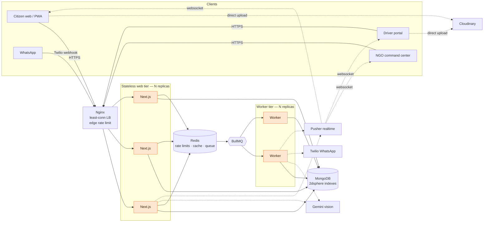
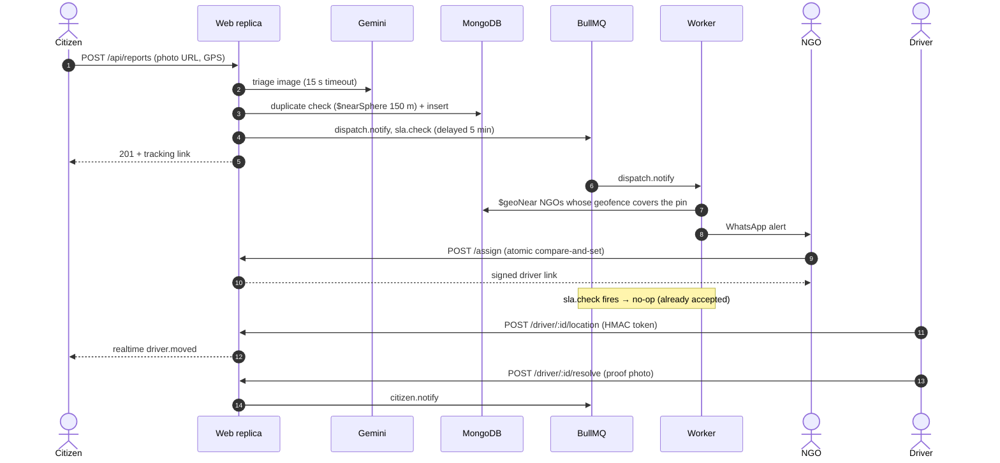

<div align="center">

# 🐄 Cowscue

**Real-time, AI-assisted rescue dispatch for injured stray cattle.**

Snap a photo → AI triage → geofenced dispatch to the nearest verified NGO → live ambulance tracking → rescue.

[](https://nextjs.org/)
[](https://www.typescriptlang.org/)
[](https://www.mongodb.com/)
[](https://docs.bullmq.io/)
[](#-running-the-scaled-stack-docker--nginx)
[](#%EF%B8%8F-deploying-to-kubernetes)

[Problem](#-the-problem) · [Features](#-features) · [Architecture](#-architecture) · [Scaling](#-scaling--reliability) · [Security](#-security) · [Getting started](#-getting-started) · [Testing](#-testing) · [API](#-api-reference)

</div>

---

## 🛑 The problem

In India, thousands of abandoned cattle — often non-milking cows and male calves — are injured on roads every day. Bystanders want to help but don't know who to call. Gaushalas and rescue NGOs run on thin budgets and lose time to fake reports, duplicate calls and inefficient routing.

## 💡 The solution

Cowscue turns a citizen's photo into a dispatched rescue in seconds:

1. **Report** — a photo + GPS pin from the web app or WhatsApp.
2. **Triage** — a vision model rejects non-cattle photos, grades severity (critical / moderate / routine) and gives the bystander safe first-aid steps.
3. **Dispatch** — every partner NGO whose coverage area contains the pin gets a WhatsApp alert; the case appears live in their command center.
4. **Escalate** — if nobody accepts within the SLA (5 min for critical cases), the search radius widens automatically until someone does.
5. **Track** — the accepting NGO sends a signed link to the driver; the citizen watches the ambulance approach in real time.
6. **Recover** — the NGO uploads proof of rescue and can open a recovery fund that supporters contribute to live.

---

## ✨ Features

| | Feature | How it works |
|---|---|---|
| 🤖 | **AI triage & spam filtering** | Gemini vision with a JSON response schema returns `isCattle`, severity, injury, confidence and first-aid tips. 15 s timeout with a keyword-heuristic fallback, so a model outage never loses a report. |
| 📍 | **Geofenced dispatch** | Each NGO defines a centre + radius. A single `$geoNear` aggregation on a `2dsphere` index finds every accepting NGO whose circle contains the report. |
| ⏱️ | **SLA auto-escalation** | BullMQ delayed jobs fire per severity (5 / 15 / 30 min). Unaccepted cases widen the radius 1× → 1.5× → 2× → broadcast within 100 km, with a live countdown in the dashboard. |
| 🧭 | **Duplicate detection** | Reports within 150 m of an open case in the last 6 h are linked to it instead of re-alerting every NGO. |
| ⚡ | **Real-time command center** | Pusher private channels push new cases, status changes and driver GPS to every responder; map-first ops console with queue, SLA timers, case sheet and analytics. |
| 🚑 | **Signed driver portal** | No account needed: drivers get an HMAC-signed, report-scoped, expiring link. Live GPS (throttled, wake-lock), ETA, navigation and proof-of-rescue upload. |
| 🗺️ | **Route optimisation** | Select several cases → OSRM trip API solves the travelling-salesperson order → open in Google Maps or send to the driver on WhatsApp. |
| 📱 | **WhatsApp reporting** | Twilio webhook acknowledges instantly; a worker downloads media, triages it, files the report and replies — plus status updates when the case is accepted and resolved. |
| 💝 | **Recovery crowdfunding** | NGOs open a fund per rescue; donations go to an append-only ledger with idempotency keys and stream live to the tracker (demo payment provider — no real money moves). |
| 📊 | **Public impact dashboard** | Anonymised live metrics: rescues over time, severity mix, median response/resolution time, demand heatmap (coordinates coarsened to ~1 km) and partner directory. |
| 🏆 | **Karma leaderboard** | Citizens earn karma for reports and successful rescues, with Helper → Rescuer → Protector → Guardian tiers. |
| 🛡️ | **NGO onboarding & admin** | Application flow with geofence setup; superadmin console to approve, reject or suspend partners (suspension takes effect immediately server-side). |
| 🎨 | **Modern, accessible UI** | Design-token system with light/dark mode, Radix primitives (focus-trapped dialogs and sheets), mobile dock, skeleton states, reduced-motion support, PWA manifest, dynamic OG images for shared rescues. |

---

## 🏗 Architecture



### Layers

```
src/
├── app/                 Routes: React pages + thin API controllers (≈10 lines each)
├── server/
│   ├── config/env.ts    Zod-validated config + feature flags (every integration optional)
│   ├── http/route.ts    route() wrapper: auth, roles, rate limit, validation, errors, request ids, access logs
│   ├── auth/identity.ts Server-authoritative roles (superadmin by email, NGO from Mongo), cached 60 s
│   ├── services/        Domain logic: reports lifecycle, dispatch, triage, donations, stats, NGOs
│   ├── models/          Mongoose schemas + indexes
│   ├── queue/           Job contracts, BullMQ producer (inline fallback), idempotent handlers
│   └── lib/             Redis, sliding-window rate limiter, read-through cache, HMAC tokens, geo, logger
├── worker/index.ts      BullMQ consumer process (scaled independently)
├── components/          Design system (ui/), maps, shared UI
└── types/               Client-safe DTOs, channel/event names, SLA policy
```

Route handlers never touch the database directly — they validate input and call a service. Services throw typed `AppError`s and never know about HTTP. DTO mappers (`serializers.ts`) are the only way report data leaves the server, which makes it structurally impossible to leak a reporter's phone number through a public endpoint or realtime channel.

### Rescue lifecycle



---

## 📈 Scaling & reliability

| Concern | Approach |
|---|---|
| **Horizontal scaling** | Web replicas are stateless (sessions are Clerk JWTs, state in Mongo/Redis), so any replica can serve any request. Nginx uses `least_conn` and re-resolves the service every 10 s so `--scale web=N` takes effect without a reload. Kubernetes HPA scales web 3→20 and workers 2→10 on CPU. |
| **Load balancing & failover** | Passive health checks (`max_fails`), `proxy_next_upstream` retries on another replica, upstream keep-alive pool, `/api/health` liveness and `/api/ready` readiness (Mongo + Redis) so the balancer stops routing to a replica that lost its database. Zero-downtime rolling updates with a PodDisruptionBudget and `preStop` drain. |
| **Async work** | Slow or flaky work — WhatsApp fan-out, SLA timers, inbound WhatsApp processing — runs on a separate worker tier via BullMQ with retries and exponential backoff. Without Redis the same handlers run in-process after the response (`after()`), so local dev needs zero infra. |
| **Idempotency** | Every job handler re-reads state and checks preconditions (at-least-once delivery is safe); deterministic job ids deduplicate enqueues; donations take an `Idempotency-Key`. |
| **Concurrency** | Case acceptance is a single `findOneAndUpdate({status: "pending"})` compare-and-set — two NGOs clicking accept at the same instant get exactly one 200 and one 409, across any number of replicas, without locks. |
| **Rate limiting** | Two layers: Nginx per-IP limits at the edge, plus a Redis **sliding-window counter** in the app (per user or IP, per endpoint class), shared across replicas, with a per-process fallback. |
| **Caching** | Read-through Redis cache with **request coalescing** (stampede protection) for public stats, leaderboard and NGO directory; invalidated on state changes; `s-maxage` headers for CDNs. |
| **Database** | 2dsphere indexes for geo queries; compound indexes matching each dashboard's access pattern; one `$facet` aggregation computes all public metrics in a single round-trip; connection pooling tuned per tier. |
| **Graceful degradation** | Gemini down → heuristic triage. Pusher down → clients poll. Twilio missing → alerts logged. Redis missing → in-memory limits and inline jobs. |
| **Observability** | Structured JSON logs (pino) with PII redaction, request ids propagated from Nginx (`X-Request-ID`) through every log line, per-request latency, job timings, `/api/ready` exposing queue depth. |

**Measured locally** (MacBook, Docker Desktop, 3 web replicas + 2 workers): a 50-connection single-IP flood of ~15,000 req/s was absorbed by the Nginx edge limiter at **p99 7.6 ms** while the app replicas stayed under 0.4 % CPU; requests that passed were spread evenly across the three replicas. The full rescue lifecycle smoke test passes end-to-end through the load balancer.

---

## 🔐 Security

- **Server-authoritative roles** — NGO access comes from an *approved* record in Mongo (not client-editable metadata); superadmins from `SUPERADMIN_EMAILS`. Suspending a partner revokes access within the identity-cache TTL.
- **Ownership checks** — only the NGO handling a case can resolve it, close it or run its fundraiser.
- **Signed driver links** — HMAC-SHA256 over `reportId + expiry`, verified with `timingSafeEqual`; scoped to one rescue, expire after 48 h, can't be extended or reused.
- **PII minimisation** — public tracker and realtime channels carry no phone numbers; the ops feed is a Pusher **private** channel authorised server-side; public maps use ~1 km coarsened coordinates; leaderboard shows first name + initial.
- **Input validation** — Zod schemas on every endpoint (shared with the client), Cloudinary host verification by parsed hostname (not substring), Twilio webhook signature verification, constant-time bot-secret comparison.
- **Abuse controls** — edge + app rate limits, AI spam rejection, duplicate detection.
- **Hardening headers** — HSTS, `X-Frame-Options`, `nosniff`, strict `Permissions-Policy`, no `X-Powered-By`; containers run as non-root.

---

## 🚀 Getting started

### Prerequisites

Node.js ≥ 20.9. Accounts for **Clerk** and **MongoDB** are required; Gemini, Cloudinary, Pusher, Twilio and Redis are optional and degrade gracefully.

```bash
git clone https://github.com/Siddharth-singh2111/cowscue.git
cd cowscue
npm ci
cp .env.example .env      # fill in your keys
```

### Minimal (single process, no Redis)

```bash
npm run db:migrate        # idempotent: backfills v2 fields, ensures indexes
npm run db:seed           # optional demo data (3 NGOs, 28 reports) — remove with --reset
npm run dev               # http://localhost:3000
```

### With the queue (two terminals)

```bash
docker run -d -p 6379:6379 redis:7.4-alpine   # then set REDIS_URL=redis://localhost:6379
npm run dev
npm run worker
```

For WhatsApp webhooks on localhost, expose port 3000 with a tunnel, set `NEXT_PUBLIC_APP_URL` to the tunnel URL and point the Twilio sandbox at `<url>/api/webhook/twilio`.

### 🐳 Running the scaled stack (Docker + Nginx)

```bash
docker compose up -d --build --scale web=3 --scale worker=2
open http://localhost:8080

# Watch the load balancer rotate across replicas
for i in 1 2 3 4 5 6; do curl -s localhost:8080/api/health; echo; done

# Load test through the balancer
npm run loadtest -- --url http://localhost:8080 --c 50 --d 15
```

The stack uses `MONGODB_URI` from `.env`. To run fully offline, start the bundled MongoDB with `--profile local-db` and set `MONGODB_URI=mongodb://mongo:27017/cowscue`.

### ☸️ Deploying to Kubernetes

```bash
kubectl create namespace cowscue
kubectl -n cowscue create secret generic cowscue-secrets --from-env-file=.env
kubectl apply -f infra/k8s/cowscue.yaml
```

`infra/k8s/cowscue.yaml` defines web + worker Deployments (rolling updates, zone spread, readiness/liveness probes), HorizontalPodAutoscalers, a PodDisruptionBudget and an Ingress with TLS. Use managed Redis and MongoDB Atlas in production.

---

## 🧪 Testing

```bash
npm run lint && npm run typecheck
npm test                  # 42 unit tests (Vitest)
npm run smoke             # end-to-end lifecycle against a running instance
```

**Unit tests** cover the HTTP wrapper (auth/roles, validation envelopes, error masking, rate limiting, request-id propagation), signed driver tokens (forgery, expiry, cross-report reuse), the sliding-window limiter, geo maths and escalation policy, triage fallback, PII-free serialisation, and input validation.

**Smoke test** (`scripts/smoke.ts`) drives a real instance through 11 checks: report → duplicate detection → worker dispatch → PII-free tracker → concurrent-accept race (exactly one winner) → driver-token enforcement → GPS / en-route → idempotent donations → driver resolution → idempotent SLA escalation → validation errors. It cleans up after itself.

CI (`.github/workflows/ci.yml`) runs lint, typecheck and tests on every push and builds both Docker images.

---

## 📚 API reference

All endpoints return JSON. Errors use `{ error, code, details? }` with proper status codes (400 validation, 401/403 auth, 404, 409 state conflict, 422 not-cattle, 429 rate limited with `Retry-After`).

| Method | Path | Access | Purpose |
|---|---|---|---|
| `GET` | `/api/health` · `/api/ready` | public | Liveness · readiness (Mongo, Redis, queue depth, feature flags) |
| `GET` | `/api/me` | public | Current user's server-side role |
| `POST` | `/api/reports` | user | Report an emergency (AI triage, duplicate check, dispatch) |
| `GET` | `/api/reports?lat&lng&radius` | NGO | Command-center feed for an area |
| `GET` | `/api/reports/mine` | user | Citizen's reports + karma |
| `GET` | `/api/reports/:id` | public | PII-free tracking view |
| `POST` | `/api/reports/:id/assign` | NGO | Accept (atomic) → returns signed driver link |
| `POST` | `/api/reports/:id/resolve` · `/close` | NGO (owner) | Resolve with proof · close with reason |
| `PUT` | `/api/reports/:id/fundraiser` | NGO (owner) | Open / pause recovery fund |
| `GET`/`POST` | `/api/reports/:id/donations` | public | Supporters feed · pledge (`Idempotency-Key`) |
| `GET` | `/api/driver/:id` | driver token | Mission details |
| `POST` | `/api/driver/:id/location` · `/resolve` | driver token | GPS heartbeat · mark safe |
| `GET`/`POST` | `/api/ngo/apply` | user | Application status · apply |
| `GET`/`PATCH` | `/api/ngo/profile` · `PATCH /api/ngo/status` · `GET /api/ngo/stats` | NGO | Workspace settings · availability · analytics |
| `GET` | `/api/stats` · `/api/leaderboard` · `/api/ngos` | public | Impact metrics · leaderboard · partner directory |
| `GET`/`POST` | `/api/admin/overview` · `/api/admin/applications[/:id/approve\|reject\|suspend]` | superadmin | Platform overview · partner review |
| `POST` | `/api/realtime/auth` | NGO | Pusher private-channel authorisation |
| `POST` | `/api/webhook/twilio` · `/api/webhook/whatsapp` | signed | Twilio inbound · legacy self-hosted bot |

---

## 🧰 Tech stack

**Frontend** — Next.js 16 (App Router, React 19), Tailwind CSS v4 design tokens, Radix UI primitives, Motion, Recharts, React-Leaflet + OpenStreetMap, SWR, Clerk.
**Backend** — Next.js route handlers on a service layer, MongoDB (Mongoose, 2dsphere), Redis (ioredis), BullMQ, Zod, pino.
**Integrations** — Google Gemini (vision triage + assistant), Pusher Channels, Twilio WhatsApp, Cloudinary, OSRM.
**Infra** — Docker multi-stage images, Nginx load balancer, Docker Compose, Kubernetes (HPA, PDB, Ingress), GitHub Actions.

The `cowscue-bot/` folder contains an optional legacy self-hosted WhatsApp bot (whatsapp-web.js); the Twilio webhook is the recommended path.

<div align="center"><br/>Built to give a voice to the voiceless. 💚</div>
